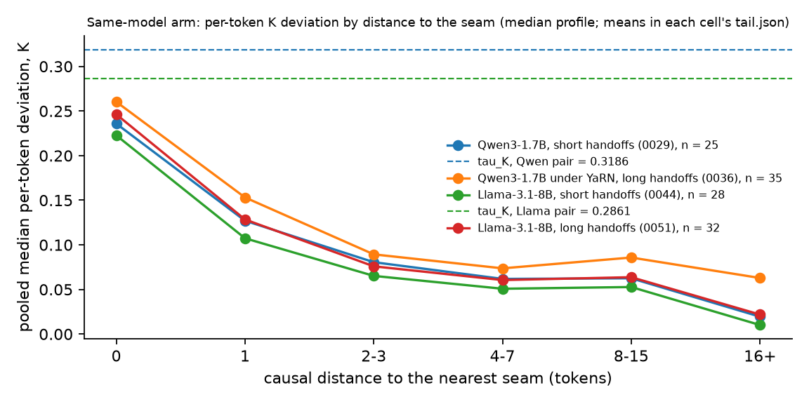

<h1 align="center">linear-ceiling: KV cache reuse at agent handoffs, on the record</h1>

<p align="center">
  <a href="https://openreview.net/forum?id=kEGVswNFaq"></a>
  <a href="https://github.com/hossainpazooki/linear-ceiling/actions/workflows/ci.yml"></a>
  <a href="LICENSE"></a>
  <a href="proofs/README.md"></a>
</p>

The pre-registered experiment record behind *KV Cache Drift Across Handoffs in Long-Horizon Agents* (NeurIPS 2026
Workshop on Long Context Foundation Models) and its MLSys 2027 extension. When a language model reads a prompt it
builds a **KV cache**, an internal record that saves it from processing the same text again. An agent handoff
re-renders that prompt: same content at new positions, new tokens at the seam, sometimes a different model. This
repository measures how far the cache drifts at real handoffs, with every number recomputed from raw output and every
rule committed before its run.

<p align="center">
  
</p>

<p align="center"><sub>Drawn by <code>tools/readme_figure.py</code> from each cell's summary file, which it refuses to read unless the file's sha256 is the one the ledger pins.</sub></p>

## Table of contents

- [Overview](#overview)
- [Get started](#get-started)
- [Reproduce a cell](#reproduce-a-cell)
- [How the record is built](#how-the-record-is-built)
- [Data](#data)
- [Formal proofs](#formal-proofs)
- [Contributing](#contributing)
- [Documentation](#documentation)
- [Citation](#citation)

## Overview

**The instrument.** For each handoff, the sender's prompt and the receiver's prompt are aligned token by token; on
the matched tokens, the receiver's own KV at the new positions is compared with its KV at the original positions.
The per-token deviation is centred and expressed in the units of a cross-model linear mapper's R², so the same
yardstick covers both arms. The statistic is f*(τ): the smallest fraction of matched tokens an oracle must remove
before the **mean** deviation of the rest is at or below τ, where τ_K is the pair's own k = 1 mapper's held-out
shortfall. A cell HOLDS at f* ≤ 0.15 and DEGRADES at f* ≥ 0.50, rules registered before any run (entry 0023).
f* is a statement about the mean, not a per-token bound and not a recompute cost in either direction (entry 0058).

**What the record says.** Medians over handoffs, four decimals, read from each cell's summary file; the entry decides
the cell and nothing else does.

| cell | pair, receiver | n | same-model f*(τ_K) | cross-model f*(τ_K) | verdict | entry |
|---|---|---|---|---|---|---|
| E9, short handoffs | Qwen3-0.6B → 1.7B, native | 25 | 0.0000 | 0.9286 | H-E9 HELD | 0029 |
| E9-long, 35K–80K-token senders | same pair, receiver under YaRN | 35 | 0.0000 | 0.9640 | H-E9L HELD | 0036 |
| second family, short | Llama-3.2-3B → 3.1-8B, native | 28 | 0.0000 | 0.7317 | H-E9F HELD | 0044 |
| second family, long | same pair, native (no scaling) | 32 | 0.0000 | 0.7626 | descriptive | 0051 |

Three descriptive findings sit beside the decided cells. The receiver configuration alone reproduces a share of
0.4285 of the short-to-long far-from-seam difference on identical tokens (entry 0038). Truncating the long senders to
four lengths under the same receiver leaves the far-from-seam median at 0.0868, above both the scaled-short reference
0.0381 and the long reference 0.0629, so length is not attributed as the cause (entry 0057, "unattributed"). On
public agent traces, model switches are too rare for cross-model headroom to be material, and the traces omit what
full cache accounting needs, so the cost figures are bounds (entries 0015, 0018, 0022, 0024). The hypothesis table at
the top of `ledger/ledger.md` carries every verdict with its rule.

**What it does not say.** The results motivate testing practical reuse within a model. They do not validate a routing
policy, do not price a recompute, and do not rule out cross-model reuse with other maps or calibration data. The scope
boundary registered at the start still holds:

> The screen predicts what a linear mapper can achieve; retention asymmetry beyond that
> prediction is measured and attributed receiver-side, not explained.

## Get started

Five minutes, no GPU, no token. Install, run the three gates, then check one published run record against the ledger.

```bash
git clone https://github.com/hossainpazooki/linear-ceiling.git && cd linear-ceiling
uv venv --python 3.12 .venv && source .venv/bin/activate      # Windows: .venv\Scripts\activate
uv pip install torch --index-url https://download.pytorch.org/whl/cpu
uv pip install -e ".[dev]"
python -m linear_ceiling.seal verify && python -m linear_ceiling.lint_scope && python -m linear_ceiling.ledger_check
```

```
OK (no sealed predictions yet)
scope ok
ledger ok (blocks unchanged vs HEAD)
```

`pytest` runs 598 offline tests on synthetic fixtures. On a Windows checkout the tests that execute the repository's
shell scripts fail on CRLF line endings; the Linux CI run is the gate. Now fetch the E9-long run record from its
public dataset and compare its hash with the line the ledger pinned before the figures were written:

```bash
python - <<'EOF'
from huggingface_hub import hf_hub_download
import hashlib
p = hf_hub_download("hossainpazooki/linear-ceiling-e9l-2026-09-10", "results/e9l/report.json", repo_type="dataset")
print(hashlib.sha256(open(p, "rb").read()).hexdigest()[:12])
EOF
grep -n "084d9480af74" ledger/ledger.md | cut -c1-60
```

```
084d9480af74
3034:084d9480af74, `summary.json` 64e64e9318d4.
```

The bytes on the Hub are the bytes entry 0045 read. Every figure in the table above is recomputed from a record like
this one by a summarizer that refuses on any mismatch; the full chain from a printed figure to its bytes, for every
cell, is `docs/paper-to-record.md`.

## Reproduce a cell

Every experiment runs through the same moves, and each refuses until the one before it is on the record:

```bash
python -m linear_ceiling.e9 --check --config config/e9l.toml            # gate: registering entries committed, upstream at its pin, mapper by sha
python -m linear_ceiling.e9 --align-only --config config/e9l.toml       # CPU: alignments, coverage, run order, keep draw (what the entry cites)
python -m linear_ceiling.summarize_e9 --calibrate-tau --config config/e9l.toml   # CPU: tau from the archived mapper, before any prefill
python -m linear_ceiling.e9 --config config/e9l.toml                    # GPU: dump, score, delete per handoff; checkpointed
python -m linear_ceiling.summarize_e9 --config config/e9l.toml          # fail-closed: every figure from the raw record, or a refusal
python -m linear_ceiling.e9_tail --config config/e9l.toml               # the per-token tail beside the mean (entry 0045)
```

What the GPU step needs and does not ship: the public agent trajectories under `traces/` (rebuilt from
`config/e7-manifest.json` by `e7_manifest fetch`), the pinned upstream instrument named in `UPSTREAM.md` (invoked
by subprocess; the gate refuses if its pin does not hold), the pair's mapper, and one 40–80 GB card for one sitting.
Each sitting has a dated runbook listed in `docs/README.md`, and the standing rules R1–R12 are in
`docs/gpu-experiment-protocol.md`. The complete command reference, with what each gate refuses until, is
`docs/agent/experiment-commands.md`.

## How the record is built

The repository treats each result like a registered experiment, not an editable report: the rule and thresholds are
committed before a run, a summarizer recalculates each reported number from the raw output and stops on a mismatch,
and the numbered entries are hash-chained and checked in CI so a later edit fails the build. A green suite proves the
tools work; it does not prove a scientific claim. Mapped to files:

| stage | where | what it enforces |
|---|---|---|
| hypotheses, rules, verdicts | `ledger/ledger.md` | numbered immutable entries; the table at the top is decided only by an entry with a `verdict:` line |
| chain and provenance check | `src/linear_ceiling/ledger_check.py`, CI | sha chain over entries, block diff against the base revision, verdict-cell provenance, manifest citation |
| registration | `config/*.toml`, `docs/drafts/append_00NN.py` | a config is committed unmodified before its run; an append script reads every figure in-process and refuses a stale file; `docs/drafts/README.md` is the only number allocator |
| gates | `e7.assert_ready`, `e8`, `e9 --check`, `upstream_gate.py` | refuse until the registering entries are committed and the upstream instrument sits at its pinned commit, clean |
| corpus | `e7_manifest.py`, `e7_traces.py`, `e7_corpus.py` | the committed manifest hashes every trace file; the driver refuses if disk and manifest disagree |
| alignment and statistic | `e9_align.py`, `e9_pertoken.py` | the registered handoff slices and matched blocks; entry 0023's deviation, f*(τ), seam distance, null pairing, band |
| drivers | `e7.py`, `e8.py`, `e9.py`, `e9_rescore.py` | checkpointed per handoff; dump, score, delete; never import the upstream |
| summarizers | `summarize_e7.py`, `summarize_e8.py`, `summarize_e9.py`, `e9_tail.py`, `e9_compare.py`, `summarize_e9_trunc.py` | fail-closed: alignments re-derived from raw traces, moments re-summed, keep subsets re-scored from fingerprinted tensors, τ recomputed |
| quantiles | `e7_stats.py` | the one pinned over-handoff convention (lower nearest-rank); pooled per-token p90/p99 fields are `np.quantile` and the record says so |
| scope and seal | `lint_scope.py`, `seal.py` | the scope sentence appears once, verbatim, and is never paraphrased; sealed predictions are hash-verified |
| paper paste source | `docs/drafts/tables/T<nn>-*.md` | each printed table or paragraph with both source forms (entry:line and summary-file sha), its conventions and an executable re-verify line; immutable once approved |
| GPU box drivers | `tools/runpod/`, `tools/ec2/`, `tools/jupyterhub/`, `tools/hf_backup.sh`, `tools/hf_verify_backup.py` | launch, pull, release and back up under protocol R1–R12; every backup file verified in both directions |

## Data

Raw model outputs never enter git history. Each GPU run's tensors are backed up to a Hugging Face dataset after the
run is verified at home; the backup is transport, not evidence, and `tools/hf_verify_backup.py <repo_id> <local_root>`
checks every file in both directions before it counts. All eight datasets are public and need no token (the second
family's long cell, `e9fl`, was made public on 2026-10-13).

| dataset | what it holds | entries |
|---|---|---|
| [`hossainpazooki/linear-ceiling-e9-2026-09-04`](https://huggingface.co/datasets/hossainpazooki/linear-ceiling-e9-2026-09-04) | the same-model handoff experiment on the 25 shorter handoffs | 0026–0029 |
| [`hossainpazooki/linear-ceiling-n420-2026-09-08`](https://huggingface.co/datasets/hossainpazooki/linear-ceiling-n420-2026-09-08) | the larger calibration set behind the cross-model map's sensitivity check | 0033–0034 |
| [`hossainpazooki/linear-ceiling-e9l-2026-09-10`](https://huggingface.co/datasets/hossainpazooki/linear-ceiling-e9l-2026-09-10) | the long-context run on the 35 longer handoffs | 0035–0036 |
| [`hossainpazooki/linear-ceiling-e9s-2026-09-13`](https://huggingface.co/datasets/hossainpazooki/linear-ceiling-e9s-2026-09-13) | the 25 shorter handoffs re-run under the long run's scaled receiver | 0037–0038 |
| [`emmmy/linear-ceiling-e8f-2026-09-18`](https://huggingface.co/datasets/emmmy/linear-ceiling-e8f-2026-09-18) | the second model family's calibration (Llama-3.2-3B → Llama-3.1-8B): dumps, the k = 1/4/8 mappers | 0040 |
| [`emmmy/linear-ceiling-e9f-2026-09-19`](https://huggingface.co/datasets/emmmy/linear-ceiling-e9f-2026-09-19) | the second model family's short cell | 0042–0044 |
| [`hossainpazooki/linear-ceiling-e9fl-2026-10-07`](https://huggingface.co/datasets/hossainpazooki/linear-ceiling-e9fl-2026-10-07) | the second model family's long cell at a native receiver | 0050–0051 |
| [`hossainpazooki/linear-ceiling-e9t-2026-10-08`](https://huggingface.co/datasets/hossainpazooki/linear-ceiling-e9t-2026-10-08) | E-TRUNC: the 35 long handoffs at four sender-truncation levels | 0055, 0057 |

Protocol R8 in `docs/gpu-experiment-protocol.md` governs the push and the restore; after a restore the gates decide,
not the download.

## Formal proofs

`proofs/` is a Lean 4 formalization of the paper's theory: the registered statistic (`fstar` is the exact-criterion
twin of `e9_pertoken.f_star`), Theorem 1 (μ = 1 − R̄²), Theorem 2, Corollary 3 on seams and Proposition 4 on attention
under the RoPE assumption, with the reported numbers the theorems explain. `proofs/README.md` maps each paper statement
to its theorem, pins the toolchain, and states the build's status plainly: it has not run in CI, and the paper makes no
claim that rests on it.

## Contributing

- `main` is protected: every change arrives by pull request with the CI `test` check, merged as a merge commit, never
  squashed or rebased.
- `results/`, `data/` and `traces/` never enter a pull request. A co-author's GPU run enters the ledger by the
  admission procedure in `docs/2026-10-03-co-author-run-admission.md`: upload by the runner, refutation by the operator.
- A ledger entry is appended only by its append script under `docs/drafts/`, which reads every figure from the
  summary file in-process; the entry number comes from `docs/drafts/README.md` at staging time.
- A paper figure is printed only from a `docs/drafts/tables/T<nn>` file whose re-verify line has been run.

## Documentation

| if you want to | read |
|---|---|
| trace a paper figure to its bytes | `docs/paper-to-record.md` |
| read what the MLSys draft changes from the camera-ready | `docs/paper/2026-10-08-mlsys-draft-plan-and-second-pair-section.md`, then `docs/drafts/tables/` |
| understand why the program asked these questions | `docs/background.md`, `docs/gap-map.md`, `docs/2026-09-06-gap-map-revisited.md` |
| find a runbook, seed, design or status note | `docs/README.md` |
| work in the repo as an agent | `AGENTS.md`; `docs/agent/repo-architecture.md` for the module map |
| see what went wrong before and how it was caught | the ledger's corrective entries (0021, 0045, 0058, 0059) and `docs/reviews/` |

## Citation

```bibtex
@inproceedings{pazooki2026kvdrift,
  title     = {{KV} Cache Drift Across Handoffs in Long-Horizon Agents},
  author    = {Pazooki, Hossain and Nadathur, Vikram and Yan, Lingyuan and Alake, Samuel and Asad, Muhammad Zain and Yu, Emerson and Aggarwal, Ritvik and Ishmam, Md Farhan},
  booktitle = {NeurIPS 2026 Workshop on Long Context Foundation Models},
  year      = {2026},
  note      = {Non-archival},
  url       = {https://openreview.net/forum?id=kEGVswNFaq}
}
```

`CITATION.cff` carries the same reference for GitHub's cite button. Code and documents are under the Apache License 2.0
(`LICENSE`).
