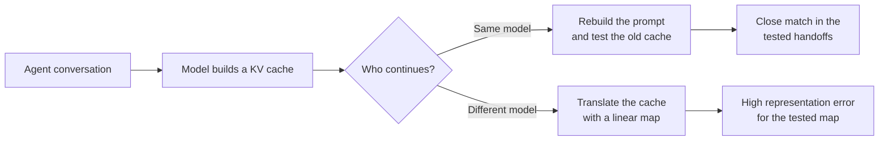

# linear-ceiling

[](https://openreview.net/forum?id=kEGVswNFaq)
[](https://github.com/hossainpazooki/linear-ceiling/actions/workflows/ci.yml)
[](LICENSE)
[](proofs/README.md)

The pre-registered experiment record behind *KV Cache Drift Across Handoffs in Long-Horizon Agents*
(NeurIPS 2026 Workshop on Long Context Foundation Models) and its MLSys 2027 extension.

Can one AI model reuse work another model has already done? When a language model reads a prompt it builds a
**KV cache**, an internal record that saves it from processing the same text again. Reusing that cache could reduce
latency and cost. This project measures cache agreement when recorded agent handoff prompts are replayed through
the same model, or through a tested cross-model map.



## Contents

- [What the experiments found](#what-the-experiments-found)
- [How the record stays auditable](#how-the-record-stays-auditable)
- [From a printed figure to its bytes](#from-a-printed-figure-to-its-bytes)
- [Where the data lives](#where-the-data-lives)
- [Setup and the gates](#setup-and-the-gates)
- [Formal proofs](#formal-proofs)
- [Where to go next](#where-to-go-next)
- [Citation](#citation)

## What the experiments found

- **Same-model cache error passed the registered reference, read on the mean.** For the 25 shorter handoffs that
  fit the model's native context, the oracle removal fraction f*(τ_K) was 0.0000 on every handoff (median, p10 and
  p90; entry 0029): the mean deviation over each handoff's matched tokens already sat inside the mapper's tolerance.
  Individual tokens do exceed it, and entry 0045 states the fraction per cell. The same held for the 35 handoffs
  with sender contexts of 35K to 80K tokens once the receiver's context window was extended to reach them (entry
  0036), and for a second model family's short cell (entry 0044); its long cell at a native receiver reads the same way,
  descriptively (entry 0051). f* is a statement about the mean, not
  about every token, and entry 0058 withdrew the earlier reading of it as a bound on recompute cost in either
  direction.
- **The tested cross-model map had much larger cache error.** A linear map trained on generic text lost accuracy on
  agent text. At the handoff, an ideal selector would still have had to remove a median of 92.86% of matched tokens
  on the shorter handoffs and 96.40% on the longer ones (entries 0029, 0036).
- **Length alone does not explain the long cohort's higher deviation.** Truncating the sender context of the same 35
  handoffs to four lengths under the same receiver left the far-from-seam deviation above both references; the
  registered reading is "unattributed" (entry 0057).
- **Public traces cannot answer the whole cost question.** Model switches were rare in the 2,904 public trajectories
  studied, and the traces omit information needed for full cache accounting. The cost figures are bounds, not
  production estimates (entries 0015, 0018, 0022, 0024).

These measurements motivate testing practical reuse within a model. They do not validate a routing policy and do
not rule out cross-model reuse with other maps or calibration data. The hypothesis table at the top of
`ledger/ledger.md` carries every decided cell with its verdict and the entries that decided it; the
[dated evidence review](docs/reviews/2026-10-01-cache-refutation-0025-0029.md) separates the verified arithmetic from
the interpretation.

## How the record stays auditable

The repository treats each result like a registered experiment, not an editable report.

1. The research rule and thresholds are committed before a run starts.
2. A summarizer recalculates each reported number from the raw output and stops on a mismatch.
3. The numbered ledger entries are hash-chained and checked in CI, so later edits fail the build.

`ledger/ledger.md` is the source of truth for hypotheses, rules, results and verdicts. A green test suite proves that
the tools work. It does not prove a scientific claim.

The original scope boundary remains fixed:

> The screen predicts what a linear mapper can achieve; retention asymmetry beyond that
> prediction is measured and attributed receiver-side, not explained.

## From a printed figure to its bytes

Every number in either paper follows one chain: paper cell → paste source (`docs/drafts/tables/T<nn>`) → ledger
entry and line → summary file with its sha256 → Hugging Face dataset holding the raw tensors. `docs/paper-to-record.md`
walks it for every figure set and ends in a re-verify line; the submitted camera-ready is reconciled row by row in
`docs/reviews/2026-10-07-submitted-camera-ready-reconciled-against-the-record-and-the-operator-runs.md`.

## Where the data lives

Raw model outputs never enter git history. Each GPU run's tensors are backed up to a Hugging Face dataset after the
run is verified at home; the backup is transport, not evidence, and every file is checked in both directions
(`tools/hf_verify_backup.py <repo_id> <local_root>`) before it counts. Seven of the eight are public and need no token;
the second family's long cell (`e9fl`) is still private as of 2026-10-11 (the Hub API answers 401 anonymously).

| dataset | what it holds | entries |
|---|---|---|
| [`hossainpazooki/linear-ceiling-e9-2026-09-04`](https://huggingface.co/datasets/hossainpazooki/linear-ceiling-e9-2026-09-04) | the same-model handoff experiment on the 25 shorter handoffs | 0026–0029 |
| [`hossainpazooki/linear-ceiling-n420-2026-09-08`](https://huggingface.co/datasets/hossainpazooki/linear-ceiling-n420-2026-09-08) | the larger calibration set behind the cross-model map's sensitivity check | 0033–0034 |
| [`hossainpazooki/linear-ceiling-e9l-2026-09-10`](https://huggingface.co/datasets/hossainpazooki/linear-ceiling-e9l-2026-09-10) | the long-context run on the 35 longer handoffs | 0035–0036 |
| [`hossainpazooki/linear-ceiling-e9s-2026-09-13`](https://huggingface.co/datasets/hossainpazooki/linear-ceiling-e9s-2026-09-13) | the 25 shorter handoffs re-run under the long run's scaled receiver | 0037–0038 |
| [`emmmy/linear-ceiling-e8f-2026-09-18`](https://huggingface.co/datasets/emmmy/linear-ceiling-e8f-2026-09-18) | the second model family's calibration (Llama-3.2-3B → Llama-3.1-8B): dumps, the k = 1/4/8 mappers | 0040 |
| [`emmmy/linear-ceiling-e9f-2026-09-19`](https://huggingface.co/datasets/emmmy/linear-ceiling-e9f-2026-09-19) | the second model family's short cell | 0042–0044 |
| [`hossainpazooki/linear-ceiling-e9fl-2026-10-07`](https://huggingface.co/datasets/hossainpazooki/linear-ceiling-e9fl-2026-10-07) | the second model family's long cell at a native receiver | 0050–0051 |
| [`hossainpazooki/linear-ceiling-e9t-2026-10-08`](https://huggingface.co/datasets/hossainpazooki/linear-ceiling-e9t-2026-10-08) | E-TRUNC: the 35 long handoffs at four sender-truncation levels | 0055, 0057 |

Protocol R8 in `docs/gpu-experiment-protocol.md` governs the push and the restore; after a restore the gates decide,
not the download.

## Setup and the gates

```bash
uv venv --python 3.12 .venv
uv pip install torch --index-url https://download.pytorch.org/whl/cpu
uv pip install -e ".[dev]"
pytest
python -m linear_ceiling.seal verify && python -m linear_ceiling.lint_scope && python -m linear_ceiling.ledger_check
```

The suite runs offline on synthetic fixtures. The Linux CI run is the gate; on a Windows checkout the tests that
execute the repository's shell scripts fail (CRLF line endings and no `bash` on the path), which CI does not share. The experiments need local data that is not in the
repository: public agent trajectories under `traces/` (rebuilt from `config/e7-manifest.json`) and the pinned
upstream repository named in `UPSTREAM.md`, which every experiment invokes by subprocess and refuses to run against
if its pin does not hold. Every experiment command, with what each gate refuses until: `docs/agent/experiment-commands.md`
(on `main` after PR #19; `CLAUDE.md` until then).

## Formal proofs

`proofs/` holds a Lean 4 formalization of the paper's theory: the registered statistic, Theorems 1 and 2, Corollary 3
and Proposition 4, with the reported numbers the theorems explain. `proofs/README.md` maps each paper statement to its
theorem and states the build's status plainly: the build has not run in CI, and the paper makes no claim that rests
on it.

## Where to go next

| if you want to | read |
|---|---|
| see every hypothesis, rule, result and verdict | `ledger/ledger.md`: the table, then the entries its cells cite |
| trace a paper figure to its bytes | `docs/paper-to-record.md` |
| understand why the program asked these questions | `docs/background.md`, `docs/gap-map.md`, `docs/2026-09-06-gap-map-revisited.md` |
| read what the MLSys draft changes from the camera-ready | `docs/paper/2026-10-08-mlsys-draft-plan-and-second-pair-section.md`, then `docs/drafts/tables/` |
| run or re-run an experiment | `docs/gpu-experiment-protocol.md` for the rules, the dated runbooks listed in `docs/README.md` |
| work in the repo as an agent or contributor | `AGENTS.md` (after PR #19; `CLAUDE.md` until then), `docs/drafts/README.md` for the next entry number |
| pick up the work where the last session left it | `docs/handoff/HANDOFF.md`, newest brief first |
| see what went wrong before and how it was caught | `docs/learnings/LEARNINGS.md` |
| find any other document | `docs/README.md` |

## Citation

```bibtex
@inproceedings{pazooki2026kvdrift,
  title     = {{KV} Cache Drift Across Handoffs in Long-Horizon Agents},
  author    = {Pazooki, Hossain and others},
  booktitle = {NeurIPS 2026 Workshop on Long Context Foundation Models},
  year      = {2026},
  note      = {Non-archival},
  url       = {https://openreview.net/forum?id=kEGVswNFaq}
}
```

`CITATION.cff` carries the same reference for GitHub's cite button. Code and documents are under the Apache License 2.0
(`LICENSE`).
